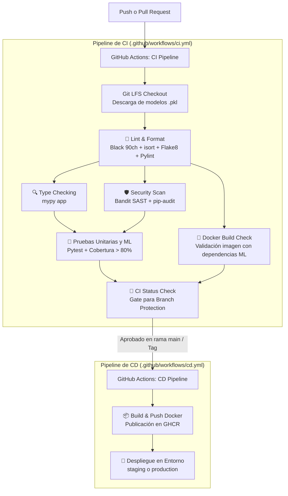

# Reto EstudIA - Plataforma de Analítica de Datos y Machine Learning 🚀

[](https://github.com/JPinzonJVC/Reto-Estud-IA/actions/workflows/ci.yml)
[](https://github.com/JPinzonJVC/Reto-Estud-IA/actions/workflows/cd.yml)
[](https://www.python.org/)
[](https://github.com/psf/black)
[](https://pycqa.github.io/isort/)
[](https://github.com/JPinzonJVC/Reto-Estud-IA)

Plataforma modular para **análisis de datos, modelos de Machine Learning (Churn y Clustering), motor de riesgo de retención, base de datos relacional PostgreSQL y tableros interactivos**, configurada con un pipeline de **CI/CD en GitHub Actions** adaptado para proyectos de analítica y ciencia de datos.

---

## 📋 Tabla de Contenidos
- [Estructura del Proyecto](#-estructura-del-proyecto)
- [Arquitectura de CI/CD para Analítica & ML](#-arquitectura-de-cicd-para-analítica--ml)
- [Gestión de Insumos y Datos Locales (Carpeta input)](#-gestión-de-insumos-y-datos-locales-carpeta-input)
- [Gestión de Modelos con Git LFS](#-gestión-de-modelos-con-git-lfs)
- [Estándares de Código](#-estándares-de-código)
- [Instalación y Configuración Local](#-instalación-y-configuración-local)
- [Ejecución de Checks y Pruebas](#-ejecución-de-checks-y-pruebas)
- [Despliegue con Docker y PostgreSQL](#-despliegue-con-docker-y-postgresql)

---

## 📂 Estructura del Proyecto

```text
Retos_StudIA/
├── .github/
│   └── workflows/
│       ├── ci.yml                     # Pipeline CI para Analítica & ML
│       └── cd.yml                     # Pipeline CD (Build & Deploy Docker)
├── app/
│   ├── database.py                    # Conexión, motor y sesiones PostgreSQL (SQLAlchemy)
│   ├── main.py                        # Entrypoint FastAPI y vistas Jinja2
│   ├── modules/
│   │   ├── retention/                 # Módulo de Retención y Fidelización
│   │   │   ├── router.py              # Endpoints REST de retención
│   │   │   ├── service.py             # Lógica y orquestación de negocio
│   │   │   └── risk_engine.py         # Motor de riesgo y recomendaciones
│   │   ├── machine_learning/          # Pipeline y Modelos de ML
│   │   │   ├── features.py            # Ingeniería de características
│   │   │   ├── preprocessing.py       # Saneamiento y normalización
│   │   │   ├── training.py            # Entrenamiento y guardado de modelos
│   │   │   ├── prediction.py          # Inferencia (Churn y Clustering)
│   │   │   └── models/                # Artefactos serializados (.pkl)
│   │   ├── analytics/                 # Módulo de Analítica y Métricas
│   │   │   └── router.py
│   │   └── affiliates/                # Módulo de Red de Afiliados
│   │       └── router.py
│   ├── templates/                     # Plantillas HTML con Jinja2
│   │   ├── dashboard/index.html
│   │   ├── retention/retention.html
│   │   ├── affiliates/affiliates.html
│   │   └── analytics/analytics.html
│   └── static/                        # Recursos estáticos
│       ├── css/style.css
│       └── js/main.js
├── input/                             # Insumos de datos locales (.csv, .parquet) [NO sube a Git]
│   └── .gitkeep
├── scripts/
│   ├── flake8_run.py                  # Script de validación PEP 8 (90 chars)
│   └── pylint_run.py                  # Script de análisis estático con pylint-exit
├── tests/                             # Suite de pruebas unitarias
│   ├── test_database.py               # Pruebas de configuración y conexión a base de datos
│   ├── test_features.py               # Pruebas de extracción de variables
│   ├── test_preprocessing.py          # Pruebas de transformaciones
│   ├── test_risk_engine.py            # Pruebas de motor de riesgo
│   ├── test_prediction.py             # Pruebas de inferencia ML
│   └── test_endpoints.py              # Pruebas de endpoints y servicios
├── .dockerignore
├── .flake8
├── .gitattributes                     # Configuración de Git LFS para .pkl
├── .gitignore                         # Exclusiones de Git (ignora input/*, .csv, .parquet)
├── .pre-commit-config.yaml
├── .pylintrc
├── docker-compose.yml                 # Orquestación con App y PostgreSQL
├── Dockerfile                         # Multi-stage build optimizado para ML
├── example.env                        # Variables de entorno de ejemplo con PostgreSQL
├── pyproject.toml                     # Configuración unificada de herramientas
├── requirements.txt                   # Dependencias (Pandas, Scikit-learn, SQLAlchemy, etc.)
└── requirements-dev.txt               # Herramientas de linters, testing y seguridad
```

---

## 📥 Gestión de Insumos y Datos Locales (Carpeta input)

La carpeta [input/](file:///D:/Retos_StudIA/input/) está destinada al almacenamiento local de fuentes de datos crudas y procesadas (`.csv`, `.parquet`, `.xlsx`):

* **Privacidad y Exclusión de Git:** Todos los archivos dentro de `input/` están explícitamente excluidos del repositorio mediante [.gitignore](file:///D:/Retos_StudIA/.gitignore) y [.dockerignore](file:///D:/Retos_StudIA/.dockerignore), conservando únicamente el archivo `input/.gitkeep`.
* **Montaje en Docker:** En `docker-compose.yml`, el directorio `./input` se monta como volumen en `/app/input`, permitiendo a los pipelines de datos acceder a los archivos locales directamente en el contenedor sin incluirlos en la imagen construida.

---

## ⚙️ Arquitectura de CI/CD para Analítica & ML

El flujo automatizado está diseñado específicamente para los retos de ciencia de datos:



---

## 📦 Gestión de Modelos con Git LFS

Los artefactos binarios de modelos (`.pkl`, `.joblib`) están configurados con **Git LFS** en [.gitattributes](file:///D:/Retos_StudIA/.gitattributes) para evitar que el historial de Git aumente de tamaño de forma descontrolada.

---

## 📐 Estándares de Código

- **PEP 8:** Longitud de línea estricta de 90 caracteres.
- **Docstrings:** Documentación en **Español** (Google Style: `Args`, `Returns`, `Raises`).
- **Linters:** Pylint calibrado al estándar QX IDI (puntuación objetivo: 10/10) y Flake8.
- **Tipado:** Tipado estático con `mypy` y compatibilidad con `numpy` y `pandas`.

---

## 🛠️ Instalación y Configuración Local

```bash
# 1. Clonar el repositorio
git clone https://github.com/JPinzonJVC/Reto-Estud-IA.git
cd Reto-Estud-IA
git lfs install
git lfs pull

# 2. Crear entorno virtual
python -m venv .venv
# En Windows (PowerShell):
.venv\Scripts\Activate.ps1
# En Linux/macOS:
source .venv/bin/activate

# 3. Instalar dependencias
pip install --upgrade pip
pip install -r requirements.txt -r requirements-dev.txt

# 4. Configurar hooks de pre-commit
pre-commit install
```

---

## 🧪 Ejecución de Checks y Pruebas

```bash
# Formateo y orden de importaciones
black --check --diff app tests scripts
isort --check-only --diff app tests scripts

# Linters y calidad de código
python scripts/flake8_run.py .
python scripts/pylint_run.py .

# Chequeo estático de tipos
mypy app

# Auditoría de seguridad
bandit -r app -c pyproject.toml
pip-audit -r requirements.txt

# Pruebas unitarias y reporte de cobertura
pytest
```

---

## 🐳 Despliegue con Docker y PostgreSQL

El entorno de contenedores orquesta la aplicación y el motor de base de datos relacional **PostgreSQL**:

- **App:** `http://localhost:8000` (Dashboard interactivo y API FastAPI).
- **PostgreSQL:** Puerto `5432` (Base de datos relacional con volumen persistente `postgres_data`).
- **Credenciales por defecto:**
  - *Usuario:* `postgres`
  - *Contraseña:* `postgres123`
  - *Base de datos:* `estudia_db`
- **Volumen de datos locales:** `./input` montado en `/app/input`.

### Levantar el entorno completo:
```bash
docker-compose up --build
```
