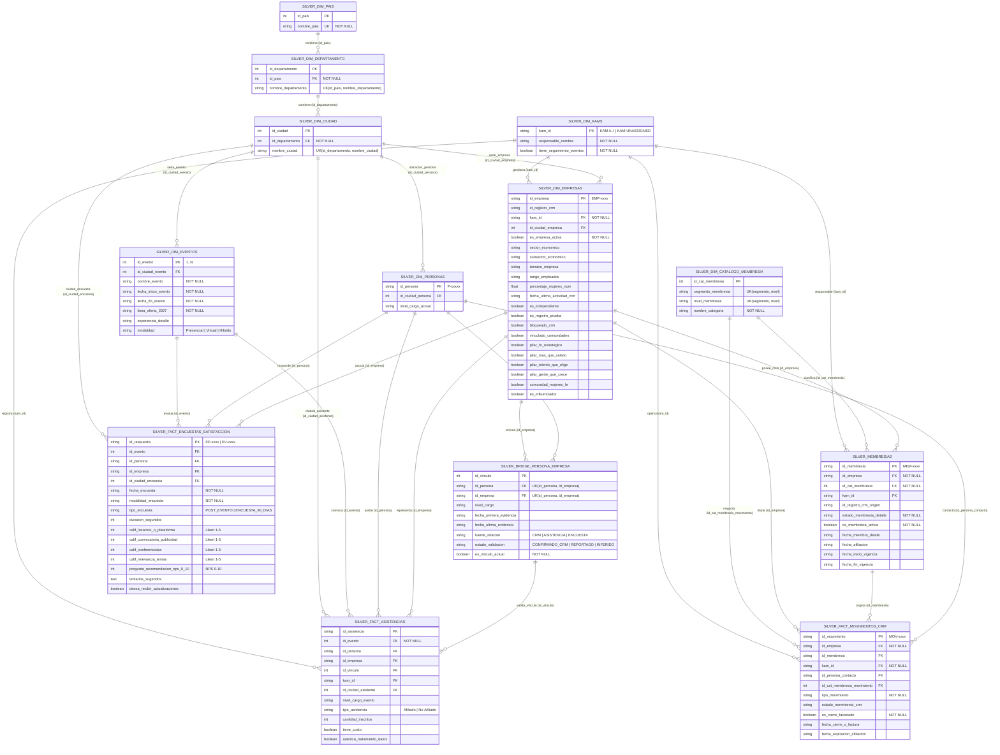
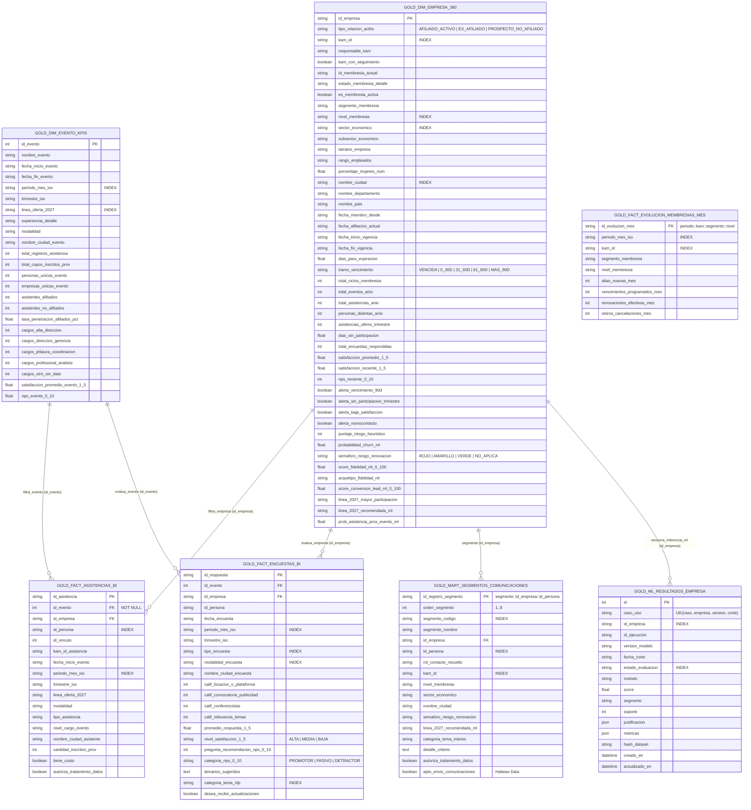
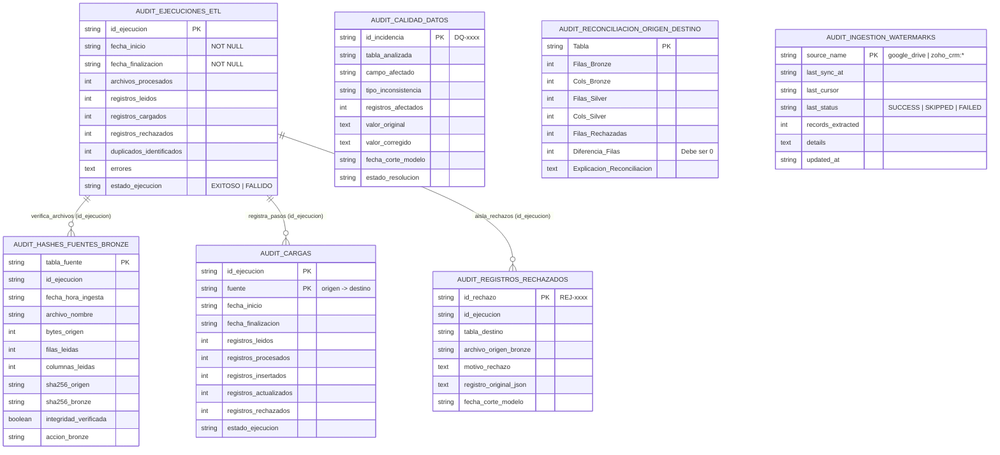
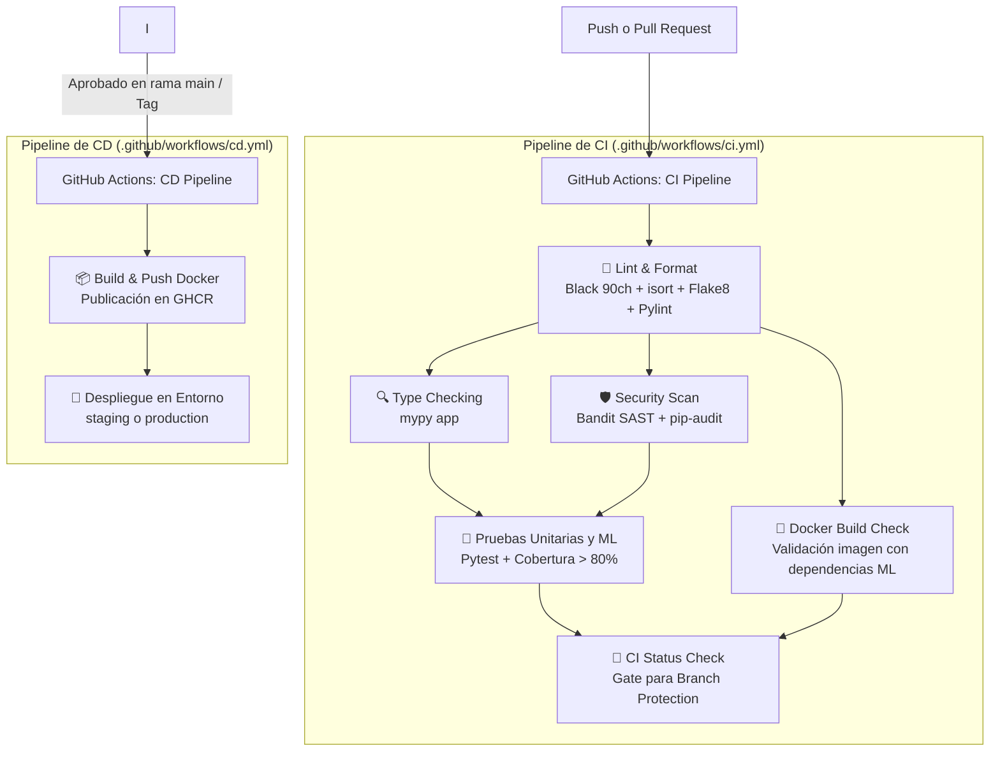

# Reto EstudIA - Plataforma de Analítica de Datos y Machine Learning 🚀

[](https://github.com/JPinzonJVC/Reto-Estud-IA/actions/workflows/ci.yml)
[](https://github.com/JPinzonJVC/Reto-Estud-IA/actions/workflows/cd.yml)
[](https://www.python.org/)
[](https://github.com/psf/black)
[](https://pycqa.github.io/isort/)
[](https://github.com/JPinzonJVC/Reto-Estud-IA)

Plataforma modular para **análisis de datos, modelos de Machine Learning (Churn y Clustering), motor de riesgo de retención, base de datos relacional PostgreSQL y tableros interactivos**, configurada con un pipeline de **CI/CD en GitHub Actions** adaptado para proyectos de analítica y ciencia de datos.

---

## 📋 Tabla de Contenidos
- [Estructura del Proyecto](#-estructura-del-proyecto)
- [Diagrama ERM de la Base de Datos (26 Tablas: Silver 3NF + Gold Estrella + Audit)](#-diagrama-erm-de-la-base-de-datos-26-tablas-silver-3nf--gold-estrella--audit)
- [Arquitectura de CI/CD para Analítica & ML](#-arquitectura-de-cicd-para-analítica--ml)
- [Gestión de Insumos y Datos Locales (Carpeta input)](#-gestión-de-insumos-y-datos-locales-carpeta-input)
- [Exclusión de Modelos y Datos del Repositorio](#-exclusión-de-modelos-y-datos-del-repositorio)
- [Estándares de Código](#-estándares-de-código)
- [Instalación y Configuración Local](#-instalación-y-configuración-local)
- [Ejecución de Checks y Pruebas](#-ejecución-de-checks-y-pruebas)
- [Despliegue con Docker y PostgreSQL](#-despliegue-con-docker-y-postgresql)

---

## 📂 Estructura del Proyecto

```text
Retos_StudIA/
├── .github/
│   └── workflows/
│       ├── ci.yml                     # Pipeline CI para Analítica & ML
│       └── cd.yml                     # Pipeline CD (Build & Deploy Docker)
├── app/
│   ├── database.py                    # Conexión, motor y sesiones PostgreSQL (SQLAlchemy)
│   ├── main.py                        # Entrypoint FastAPI y vistas Jinja2
│   ├── modules/
│   │   ├── eda/                           # Pipeline ETL Medallion (Bronze -> Silver -> Gold -> Audit -> PostgreSQL)
│   │   │   ├── config.py                  # Configuración portable hacia input/
│   │   │   ├── etl_config.json            # Parámetros de negocio y rutas Medallion
│   │   │   ├── bronze.py                  # Ingesta y verificación SHA-256
│   │   │   ├── scd2.py                    # Reconstrucción histórica SCD Tipo 2
│   │   │   ├── silver.py                  # Modelo dimensional puro y captura de rechazados
│   │   │   ├── gold.py                    # Agregaciones analíticas, preparación NPS y semáforo
│   │   │   ├── audit.py                   # Bitácoras de calidad, duplicados, rechazados y reconciliación
│   │   │   ├── models/                    # Paquete con los 18 modelos SQLAlchemy ORM y atributos documentados
│   │   │   ├── postgres_loader.py         # Carga masiva transaccional con UPSERT idempotente
│   │   │   └── pipeline.py                # Orquestador ejecutable del pipeline Medallion
│   │   ├── retention/                 # Módulo de Retención y Fidelización (Consume Gold)
│   │   │   ├── repository.py          # Consultas SQL/Parquet sobre gold_agg_retencion_empresa
│   │   │   ├── router.py              # Endpoints REST de retención
│   │   │   ├── service.py             # Lógica y orquestación de negocio
│   │   │   └── risk_engine.py         # Motor de riesgo y recomendaciones
│   │   ├── machine_learning/          # Pipeline y Modelos de ML
│   │   │   ├── features.py            # Ingeniería de características
│   │   │   ├── preprocessing.py       # Saneamiento y normalización
│   │   │   ├── training.py            # Entrenamiento y guardado de modelos
│   │   │   ├── prediction.py          # Inferencia (Churn y Clustering)
│   │   │   └── models/                # Artefactos serializados (.pkl)
│   │   ├── analytics/                 # Módulo de Analítica y Métricas (Consume Gold)
│   │   │   ├── repository.py          # Consultas sobre gold_agg_participacion y satisfaccion
│   │   │   ├── service.py             # Servicio de indicadores analíticos
│   │   │   └── router.py
│   │   └── affiliates/                # Módulo de Red de Afiliados (Consume Gold)
│   │       ├── repository.py          # Consultas sobre empresas afiliadas y participación
│   │       ├── service.py             # Servicio de desempeño de afiliados
│   │       └── router.py
│   ├── templates/                     # Plantillas HTML con Jinja2
│   │   ├── dashboard/index.html
│   │   ├── retention/retention.html
│   │   ├── affiliates/affiliates.html
│   │   └── analytics/analytics.html
│   └── static/                        # Recursos estáticos
│       ├── css/style.css
│       └── js/main.js
├── input/                             # Capas Medallion y datos locales (.csv, .parquet) [NO sube a Git]
│   ├── bronze/                        # Copia inmutable verificada con SHA-256 (.csv)
│   ├── silver/                        # Dimensiones (+SCD2) y Hechos depurados (.csv y .parquet)
│   ├── gold/                          # Agregaciones analíticas de negocio (.csv y .parquet)
│   ├── audit/                         # Hashes, duplicados, calidad y reconciliación (.csv y .parquet)
│   ├── normalizados/                  # Tablas normalizadas de entrada al ETL
│   ├── CSV/                           # 47 archivos CSV crudos originales
│   └── .gitkeep
├── notebooks/                         # Notebooks de EDA y Refactorización Dimensional
│   ├── analisis_exploratorio.ipynb
│   ├── resultados_esperados_actho.ipynb
│   └── refactorizacion_modelo_dimensional.ipynb
├── docs/                              # Documentación técnica del EDA y Modelo Medallion
│   ├── README_EDA_MEDALLION_ACTHO360.md
│   └── DOCUMENTACION_MODELO_REFACTORIZADO.md
├── migrations/                        # Migraciones Alembic del esquema Medallion
│   ├── env.py
│   └── versions/
│       └── rev_0001_initial_medallion_actho360.py
├── scripts/
│   ├── flake8_run.py                  # Script de validación PEP 8 (90 chars)
│   └── pylint_run.py                  # Script de análisis estático con pylint-exit
├── tests/                             # Suite de pruebas unitarias e integración
│   ├── test_database.py               # Pruebas de configuración y conexión a base de datos
│   ├── test_modelo_dimensional.py     # 10 pruebas del modelo dimensional Medallion
│   ├── test_postgres_medallion.py     # Pruebas de persistencia PostgreSQL, UPSERT, rollback y Backend Gold
│   ├── test_features.py               # Pruebas de extracción de variables
│   ├── test_preprocessing.py          # Pruebas de transformaciones
│   ├── test_risk_engine.py            # Pruebas de motor de riesgo
│   ├── test_prediction.py             # Pruebas de inferencia ML
│   └── test_endpoints.py              # Pruebas de endpoints y servicios
├── .dockerignore
├── .flake8
├── .gitignore                         # Exclusiones de Git (ignora input/*, models/*, .csv, .pkl)
├── .pre-commit-config.yaml
├── .pylintrc
├── docker-compose.yml                 # Orquestación con App y PostgreSQL
├── Dockerfile                         # Multi-stage build optimizado para ML
├── example.env                        # Variables de entorno de ejemplo con PostgreSQL
├── pyproject.toml                     # Configuración unificada de herramientas
├── requirements.txt                   # Dependencias (Pandas, Scikit-learn, SQLAlchemy, etc.)
└── requirements-dev.txt               # Herramientas de linters, testing y seguridad
```

---

## 🗄️ Diagrama ERM de la Base de Datos (26 Tablas: Silver 3NF + Gold Estrella + Audit)

El Data Warehouse de **ACTHO 360** persiste en PostgreSQL **26 tablas** estructuradas en tres capas del patrón Medallion (**13 en Silver 3NF**, **7 en Gold Esquema Estrella + ML** y **6 en Audit / Gobierno**).

### 1. Capa Silver — Core Data Warehouse (3NF — 13 Tablas)

Normaliza la jerarquía geográfica (`País → Departamento → Ciudad`), las dimensiones maestras (`KAMs`, `Empresas`, `Personas`, `Eventos`, `Catálogo de Membresía`), la relación muchos-a-muchos `Persona ↔ Empresa`, los ciclos reales de `Membresías` y las tres tablas de hechos transaccionales (`Asistencias`, `Encuestas de Satisfacción` y `Movimientos CRM`).



---

### 2. Capa Gold — Esquema Estrella Analítico, BI y Machine Learning (7 Tablas)

Diseñada para consumo de baja latencia desde el Dashboard Ejecutivo y los módulos de Analítica, Retención, Afiliados y Machine Learning. Conecta las dimensiones conformadas (`gold_dim_empresa_360` y `gold_dim_evento_kpis`) con los hechos enriquecidos (`gold_fact_asistencias_bi`, `gold_fact_encuestas_bi`), la evolución mensual (`gold_fact_evolucion_membresias_mes`), el data mart de comunicaciones (`gold_mart_segmentos_comunicaciones`) y el repositorio versionado de resultados de ML (`gold_ml_resultados_empresa`).



---

### 3. Capa Audit — Gobierno, Linaje, Calidad y Watermarks (6 Tablas)

Garantiza trazabilidad de punta a punta de cada corrida del pipeline ETL (`audit_ejecuciones_etl`), verificación criptográfica SHA-256 en Bronze (`audit_hashes_fuentes_bronze`), bitácora por paso (`audit_cargas`), cuarentena de rechazados (`audit_registros_rechazados`), reglas de calidad (`audit_calidad_datos`), cuadre exacto de filas (`audit_reconciliacion_origen_destino`) y cursores de sincronización incremental (`audit_ingestion_watermarks`).



---

## 📥 Gestión de Insumos y Datos Locales (Carpeta input)

La carpeta [input/](file:///D:/Retos_StudIA/input/) está destinada al almacenamiento local de fuentes de datos crudas y procesadas (`.csv`, `.parquet`, `.xlsx`):

* **Privacidad y Exclusión de Git:** Todos los archivos dentro de `input/` están explícitamente excluidos del repositorio mediante [.gitignore](file:///D:/Retos_StudIA/.gitignore) y [.dockerignore](file:///D:/Retos_StudIA/.dockerignore), conservando únicamente el archivo `input/.gitkeep`.
* **Montaje en Docker:** En `docker-compose.yml`, el directorio `./input` se monta como volumen en `/app/input`, permitiendo a los pipelines de datos acceder a los archivos locales directamente en el contenedor sin incluirlos en la imagen construida.

---

## ⚙️ Arquitectura de CI/CD para Analítica & ML

El flujo automatizado está diseñado específicamente para los retos de ciencia de datos:



---

## 🔒 Exclusión de Modelos y Datos del Repositorio

Tanto los insumos de datos (`.csv`, `.parquet`, `.xlsx`) como los artefactos binarios de modelos de Machine Learning (`.pkl`, `.joblib`, `.h5`, `.pt`, etc.) están **estrictamente excluidos del repositorio de Git** mediante [.gitignore](file:///D:/Retos_StudIA/.gitignore) y [.dockerignore](file:///D:/Retos_StudIA/.dockerignore).

* **Generación en CI:** En el pipeline de GitHub Actions, los modelos de prueba se entrenan y generan de forma autónoma al momento de la ejecución (`python -m app.modules.machine_learning.training`).
* **Persistencia Local:** Los modelos entrenados localmente se guardan en `app/modules/machine_learning/models/`, conservando únicamente el archivo marcador `.gitkeep` en control de versiones.

---

## 📐 Estándares de Código

- **PEP 8:** Longitud de línea estricta de 90 caracteres.
- **Docstrings:** Documentación en **Español** (Google Style: `Args`, `Returns`, `Raises`).
- **Linters:** Pylint calibrado al estándar QX IDI (puntuación objetivo: 10/10) y Flake8.
- **Tipado:** Tipado estático con `mypy` y compatibilidad con `numpy` y `pandas`.

---

## 🛠️ Instalación y Configuración Local

```bash
# 1. Clonar el repositorio
git clone https://github.com/JPinzonJVC/Reto-Estud-IA.git
cd Reto-Estud-IA

# 2. Crear entorno virtual
python -m venv .venv
# En Windows (PowerShell):
.venv\Scripts\Activate.ps1
# En Linux/macOS:
source .venv/bin/activate

# 3. Instalar dependencias
pip install --upgrade pip
pip install -r requirements.txt -r requirements-dev.txt

# 4. Configurar hooks de pre-commit
pre-commit install
```

---

## 🧪 Ejecución de Checks y Pruebas

```bash
# Formateo y orden de importaciones
black --check --diff app tests scripts
isort --check-only --diff app tests scripts

# Linters y calidad de código
python scripts/flake8_run.py .
python scripts/pylint_run.py .

# Chequeo estático de tipos
mypy app

# Auditoría de seguridad
bandit -r app -c pyproject.toml
pip-audit -r requirements.txt

# Pruebas unitarias y reporte de cobertura
pytest
```

---

## 🐳 Despliegue con Docker y PostgreSQL

El entorno de contenedores orquesta la aplicación y el motor de base de datos relacional **PostgreSQL**:

- **App:** `http://localhost:8000` (Dashboard interactivo y API FastAPI).
- **PostgreSQL:** Puerto `5432` (Base de datos relacional con volumen persistente `postgres_data`).
- **Credenciales por defecto:**
  - *Usuario:* `postgres`
  - *Contraseña:* `postgres123`
  - *Base de datos:* `estudia_db`
- **Volumen de datos locales:** `./input` montado en `/app/input`.

### Levantar el entorno completo:
```bash
docker-compose up --build
```
