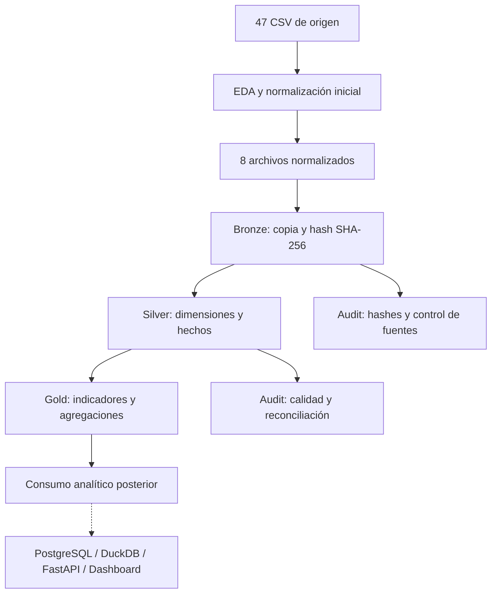

# ACTHO 360 — Análisis Exploratorio de Datos (EDA) y Modelo Medallion

> Documentación técnica del proceso de exploración, diagnóstico, preparación y transformación de los datos de ACTHO 360.  
> Alcance: notebooks de EDA y análisis de negocio, normalización de fuentes y pipeline dimensional Bronze → Silver → Gold, con una capa transversal de auditoría.

---

## Tabla de contenido

1. [Objetivo y alcance](#1-objetivo-y-alcance)
2. [Contexto y fuentes de información](#2-contexto-y-fuentes-de-información)
3. [Estructura del proyecto](#3-estructura-del-proyecto)
4. [Proceso de EDA](#4-proceso-de-eda)
5. [Hallazgos y consideraciones de calidad](#5-hallazgos-y-consideraciones-de-calidad)
6. [Arquitectura Medallion](#6-arquitectura-medallion)
7. [Modelo dimensional Silver](#7-modelo-dimensional-silver)
8. [Agregaciones Gold](#8-agregaciones-gold)
9. [Reglas de negocio y decisiones metodológicas](#9-reglas-de-negocio-y-decisiones-metodológicas)
10. [Auditoría y trazabilidad](#10-auditoría-y-trazabilidad)
11. [Configuración y ejecución](#11-configuración-y-ejecución)
12. [Pruebas y validaciones](#12-pruebas-y-validaciones)
13. [Limitaciones conocidas](#13-limitaciones-conocidas)
14. [Tecnologías](#14-tecnologías)

---

## 1. Objetivo y alcance

El trabajo de datos de ACTHO 360 parte de fuentes heterogéneas en formato CSV que contienen información de empresas afiliadas, personas, eventos, asistencias, encuestas de satisfacción y movimientos del CRM.

El proceso tiene dos objetivos complementarios:

1. **EDA (Exploratory Data Analysis):** entender la estructura, calidad, cobertura y consistencia de las fuentes; identificar problemas de formato, duplicidad, valores faltantes y relaciones entre entidades; y responder preguntas iniciales de negocio.
2. **Preparación analítica con arquitectura Medallion:** transformar los datos normalizados en un modelo dimensional trazable y reutilizable, separando los datos depurados de las métricas y agregaciones destinadas al análisis.

El resultado es un conjunto de archivos analíticos locales en CSV y Parquet. La estructura queda preparada para que una etapa posterior los cargue en PostgreSQL o los consuma DuckDB, FastAPI y los tableros. **Esta documentación no presupone que la carga a PostgreSQL ya esté implementada.**

### Principios de trabajo

- Conservar las fuentes originales sin modificarlas.
- No eliminar registros problemáticos sin dejar trazabilidad.
- Separar atributos descriptivos, hechos transaccionales y métricas derivadas.
- No completar fechas, identidades o relaciones mediante suposiciones.
- Mantener las claves de negocio originales y utilizar claves subrogadas cuando el modelo lo requiera.
- Hacer configurables los periodos y reglas de cálculo.
- Distinguir métricas observadas de indicadores estimados o heurísticos.
- Registrar los controles de calidad y la conciliación entre capas.

---

## 2. Contexto y fuentes de información

El conjunto de entrada documentado está compuesto por **47 archivos CSV** heterogéneos. Incluye exportaciones del CRM, reportes de afiliación, matrices de asistencia y archivos de eventos y encuestas.

La organización general de las fuentes es:

| Grupo de fuentes | Contenido |
|---|---|
| CRM y afiliaciones | Datos de empresas, estados de afiliación, ejecutivas y movimientos |
| Personas | Información de profesionales vinculados a empresas o participantes |
| Eventos | Catálogo de eventos y reportes individuales |
| Asistencias | Registros de participación en eventos |
| Encuestas | Respuestas de satisfacción en diferentes modalidades |
| Duplicados | Registros identificados durante la revisión y normalización |

El conjunto normalizado que alimenta el pipeline dimensional se resume en ocho archivos:

| Archivo de entrada normalizado | Filas documentadas | Propósito |
|---|---:|---|
| `dim_empresas.csv` | 1.851 | Empresas afiliadas y atributos descriptivos |
| `dim_personas.csv` | 2.892 | Personas relacionadas con la participación |
| `dim_eventos.csv` | 34 | Catálogo de eventos |
| `dim_kams.csv` | 10 | Catálogo de ejecutivas KAM y valor sin asignación |
| `fact_asistencias.csv` | 3.401 | Registros de asistencia |
| `fact_encuestas_satisfaccion.csv` | 725 | Respuestas de encuestas |
| `fact_movimientos_crm.csv` | 77 | Movimientos provenientes del CRM |
| `registros_duplicados.csv` | 122 | Registros duplicados identificados para auditoría |

> Los conteos corresponden al conjunto documentado para esta versión del análisis. Si se actualizan los CSV, deben volver a calcularse y validarse; no deben asumirse como conteos permanentes.

---

## 3. Estructura del proyecto

La estructura lógica documentada es la siguiente:

```text
analisis_exploratorio/
├── README.md
├── analisis_exploratorio.ipynb
├── resultados_esperados_actho.ipynb
├── refactorizacion_modelo_dimensional.ipynb
├── data/
│   ├── CSV/                              # Fuentes originales
│   └── normalizados/                     # Archivos preparados para el modelo
│       └── duplicados/
└── modelo_refactorizado_actho360/
    ├── config/
    │   └── etl_config.json
    ├── etl/
    │   ├── config.py
    │   └── refactorizar_modelo_actho360.py
    ├── bronze/
    ├── silver/
    ├── gold/
    ├── audit/
    ├── docs/
    │   └── DOCUMENTACION_MODELO_REFACTORIZADO.md
    └── tests/
        └── test_modelo_dimensional.py
```

### Responsabilidad de los notebooks

| Notebook | Responsabilidad |
|---|---|
| `analisis_exploratorio.ipynb` | EDA de los archivos de origen, inspección de estructuras, limpieza de encabezados, tratamiento de fechas y análisis de duplicados |
| `resultados_esperados_actho.ipynb` | Análisis orientado a preguntas de negocio, indicadores exploratorios y prototipos analíticos |
| `refactorizacion_modelo_dimensional.ipynb` | Diseño y validación de la transformación dimensional bajo arquitectura Medallion |

Los notebooks son artefactos de análisis y exploración. El pipeline ETL ejecutable se encuentra en el módulo `modelo_refactorizado_actho360/`.

---

## 4. Proceso de EDA

El EDA permite conocer los datos antes de definir reglas de transformación. En este proyecto se trabaja con fuentes que no comparten necesariamente el mismo formato: existen exportaciones tabulares, reportes con encabezados agrupados, matrices de asistencia y archivos individuales por evento.

### 4.1 Inspección estructural

Para cada archivo se debe revisar:

- Nombre y propósito de la fuente.
- Cantidad de filas y columnas.
- Encabezados duplicados, vacíos o compuestos.
- Tipos de datos inferidos.
- Filas completamente vacías.
- Columnas constantes o sin información útil.
- Valores únicos y cardinalidad.
- Formatos de fechas y números.
- Posibles identificadores de negocio.

En archivos con encabezados multinivel o celdas combinadas, la lectura requiere una etapa de interpretación y normalización de encabezados antes de comparar esquemas.

### 4.2 Normalización inicial

La preparación de las fuentes contempla:

1. Homologar nombres de columnas y encabezados.
2. Eliminar filas que sean completamente vacías, cuando se confirme que no contienen información.
3. Normalizar cadenas de texto y representaciones de valores faltantes.
4. Convertir fechas a un formato consistente, preferiblemente ISO `YYYY-MM-DD`.
5. Revisar tipos numéricos y columnas que contienen números almacenados como texto.
6. Conservar identificadores originales.
7. Registrar por separado los registros duplicados detectados.

La normalización no debe modificar el significado de los datos. Por ejemplo, no se debe convertir un identificador con ceros iniciales a un número si eso altera su valor.

### 4.3 Análisis de valores faltantes

Los nulos se deben analizar por columna y por entidad. Un valor faltante no siempre representa un error: puede ser una respuesta anónima, una relación no capturada o un dato que no aplica.

Para el conjunto documentado se identificaron, entre otros, estos casos:

- 139 respuestas de encuestas sin `id_persona`.
- 142 respuestas de encuestas sin `id_empresa`.
- 15 registros de asistencia sin empresa asociada.
- 2.528 registros de asistencia sin ciudad del evento.
- 14 personas sin `id_empresa_principal`.
- 63 movimientos CRM sin fecha de expiración.
- 799 empresas sin `id_registro_crm`.

Estos casos deben conservarse y clasificarse. No se deben completar mediante cruces ambiguos o inferencias no verificables.

### 4.4 Análisis de duplicados

Se identificaron **122 registros** para revisión de duplicidad. La clasificación debe diferenciar, como mínimo:

- Duplicado exacto: todos los campos relevantes coinciden.
- Posible duplicado: hay coincidencia en claves o atributos principales, pero existen diferencias que requieren revisión.
- Registro repetido por la naturaleza del proceso: puede representar eventos o movimientos distintos y no debe eliminarse automáticamente.

El archivo de duplicados se conserva como insumo de auditoría. La existencia de un identificador repetido en una columna no implica por sí sola que la entidad completa esté duplicada.

### 4.5 Análisis de relaciones

El EDA también permite identificar claves y relaciones entre entidades:

- Empresa ↔ persona.
- Empresa ↔ ejecutiva KAM.
- Evento ↔ asistencia.
- Persona ↔ asistencia.
- Empresa/persona ↔ encuesta, cuando la fuente permite establecer esa relación.
- Empresa ↔ movimientos del CRM.

Las relaciones deben construirse con códigos de empresa y persona cuando existan. Si la fuente no incluye una clave suficiente, la relación debe permanecer sin resolver y documentarse.

### 4.6 Análisis orientado al negocio

El EDA sirve como base para explorar preguntas como:

- ¿Cuántas empresas y personas aparecen en las fuentes?
- ¿Cómo se distribuyen las empresas por estado, sector, ciudad o ejecutiva?
- ¿Qué eventos concentran más registros de asistencia?
- ¿Qué empresas registran participación?
- ¿Cómo se comportan las calificaciones de satisfacción?
- ¿Qué empresas tienen fechas de vencimiento próximas?
- ¿Qué diferencias existen entre los datos reportados por las fuentes y los registros consolidados?

Los resultados exploratorios no deben confundirse con indicadores oficiales. Cada métrica debe especificar su universo, periodo, fuente y regla de cálculo.

---

## 5. Hallazgos y consideraciones de calidad

Los siguientes hallazgos afectan directamente el diseño del modelo dimensional.

| Hallazgo | Implicación para el modelo |
|---|---|
| `dim_kams` contenía métricas agregadas | Mantener en la dimensión solo atributos descriptivos; mover métricas a agregaciones o auditoría |
| `dim_empresas` contenía métricas de participación y encuestas | Separar atributos de empresa de indicadores derivados |
| `dim_personas` contenía métricas de asistencia y encuestas | Mantener atributos de persona en la dimensión y calcular métricas en Gold |
| `dim_eventos` contenía conteos de asistentes y empresas/personas | Conservar los datos reportados para auditoría; no tratarlos como atributos descriptivos del evento |
| Valores diferentes para KAM sin asignar | Homologar a `KAM-UNASSIGNED` y preservar el valor original |
| Encuestas sin empresa o persona | Mantener respuestas anónimas/no vinculadas; no inferir identidad |
| Encuestas sin `id_evento` | No asociar respuestas a eventos por proximidad de fechas |
| Fechas incompletas en afiliaciones | Clasificar la historia sin inventar fechas |
| Identificadores CRM repetidos o nulos | No asumir que la empresa está duplicada por esa columna |

### Caso especial: `id_registro_crm`

En `dim_empresas` se documentaron 799 valores nulos y 798 valores duplicados en `id_registro_crm`. Esta situación no demuestra que existan empresas duplicadas: el identificador debe interpretarse dentro del contexto de la fuente y no sustituye la clave de negocio de la empresa.

---

## 6. Arquitectura Medallion

La arquitectura Medallion organiza el flujo en capas con responsabilidades distintas:

- **Bronze:** copia controlada de los datos normalizados de entrada.
- **Silver:** datos depurados y organizados en un modelo dimensional.
- **Gold:** agregaciones e indicadores preparados para análisis.
- **Audit:** controles de calidad, hashes, duplicados, conciliaciones y trazabilidad de las ejecuciones.



La capa Audit recibe información de los procesos y no representa una etapa de transformación analítica equivalente a Gold: es una capa transversal de gobierno y trazabilidad.

### 6.1 Bronze — conservación de las entradas

**Objetivo:** preservar una copia controlada de los ocho archivos normalizados que alimentan el ETL.

Responsabilidades:

- Verificar que los archivos de entrada existan.
- Validar que tengan tamaño mayor que cero.
- Calcular hashes SHA-256.
- Registrar los hashes en `audit_hashes_fuentes_bronze`.
- Evitar sobrescrituras silenciosas de archivos existentes.

Comportamiento documentado:

- Si el archivo Bronze ya existe y el hash coincide con el de origen, se conserva sin sobrescribir.
- Si el archivo existe y el hash es diferente, el proceso debe detenerse con un error para evitar reemplazar información histórica de forma accidental.

**Importante:** una nueva versión de los datos debe manejarse como una nueva carga o snapshot controlado. No se debe reemplazar Bronze manualmente sin definir cómo se conserva el historial.

### 6.2 Silver — datos depurados y modelo dimensional

**Objetivo:** entregar entidades y hechos con claves, tipos y responsabilidades claras.

Características:

- Dimensiones descriptivas separadas de hechos transaccionales.
- Métricas calculadas fuera de las dimensiones.
- Homologación de valores de referencia.
- Validación de claves primarias y relaciones.
- Tratamiento explícito de registros sin identidad resuelta.
- Conservación del historial de afiliación mediante SCD Tipo 2 cuando la fuente lo permite.

Las tablas se documentan en CSV (`utf-8-sig`) y Parquet. Parquet permite conservar tipos y facilitar consultas analíticas; CSV facilita inspección e interoperabilidad.

### 6.3 Gold — indicadores analíticos

**Objetivo:** construir tablas agregadas que respondan a necesidades de análisis y consumo.

Las agregaciones se calculan a partir de Silver y deben depender de parámetros externos para periodos, fechas de corte y reglas configurables.

Tablas principales:

- `agg_participacion_empresa`
- `agg_satisfaccion_encuestas`
- `agg_retencion_empresa`

Gold no debe convertirse en una copia de las dimensiones con métricas añadidas: cada agregado debe tener una granularidad definida y documentada.

### 6.4 Audit — gobierno y trazabilidad

**Objetivo:** permitir responder qué datos entraron, qué controles se ejecutaron, qué incidencias se detectaron y cómo se conciliaron las capas.

Incluye:

- Hashes de fuentes Bronze.
- Registros duplicados.
- Incidencias de calidad.
- Conciliación de conteos entre origen y destino.
- Metadatos de cargas y ejecuciones.
- Métricas reportadas por las fuentes que se conservan para comparación.

Los metadatos operativos de ejecución deben permanecer separados de las tablas analíticas para que una nueva ejecución no altere innecesariamente el contenido de negocio.

---

## 7. Modelo dimensional Silver

El modelo sigue un enfoque dimensional tipo estrella: las dimensiones describen entidades y los hechos registran eventos o transacciones medibles.

### 7.1 Dimensiones

| Tabla | Clave primaria | Filas documentadas | Descripción |
|---|---|---:|---|
| `dim_empresas` | `id_empresa` | 1.851 | Atributos descriptivos, geográficos y estado vigente de las empresas |
| `dim_empresas_scd2` | `sk_empresa_scd2` | 1.872 | Versiones históricas de las membresías |
| `dim_personas` | `id_persona` | 2.892 | Atributos descriptivos de profesionales |
| `dim_eventos` | `id_evento` | 34 | Catálogo maestro de eventos |
| `dim_kams` | `kam_id` | 10 | Catálogo de ejecutivas KAM, incluido el valor sin asignación |

### 7.2 Hechos

| Tabla | Clave primaria | Filas documentadas | Descripción |
|---|---|---:|---|
| `fact_asistencias` | `id_asistencia` | 3.401 | Registros de asistencia y resolución de identidad |
| `fact_encuestas_satisfaccion` | `id_respuesta` | 725 | Respuestas de satisfacción |
| `fact_movimientos_crm` | `id_movimiento` | 77 | Altas, renovaciones y movimientos CRM |

### 7.3 Separación de dimensiones y métricas

Las dimensiones deben describir el estado o los atributos de una entidad. Los conteos, acumulados, promedios, indicadores de participación y métricas de satisfacción deben calcularse en Gold o conservarse en Audit cuando provienen de reportes originales.

Esta separación evita que las dimensiones mezclen atributos relativamente estables con métricas cuyo valor cambia según el periodo o la definición del indicador.

### 7.4 Homologación de KAM

Los valores descriptivos usados para representar una empresa sin ejecutiva asignada se homologan al identificador canónico:

```text
KAM-UNASSIGNED
```

La homologación se aplica en las tablas relacionadas y se conserva el valor original en `kam_valor_original` para mantener trazabilidad.

---

## 8. Agregaciones Gold

### 8.1 `agg_participacion_empresa`

| Propiedad | Definición |
|---|---|
| Granularidad | Una fila por empresa y periodo de análisis |
| Clave lógica | `(id_empresa, periodo_analisis)` |
| Filas documentadas | 1.851 |
| Uso | Analizar participación, asistencia, recencia y ventanas temporales |

Incluye indicadores derivados de la participación, como eventos y asistencias, periodo calendario, ventana móvil de 90 días y recencia.

Los periodos deben parametrizarse. La versión documentada contempla trimestre calendario, trimestre operativo y ventanas móviles. La fecha de corte debe tratarse como parámetro del snapshot, no como una fecha universal.

Cuando una empresa no tiene participación registrada, no se debe fabricar una fecha de última participación ni calcular meses de inactividad a partir de una fecha inexistente. En ese caso, la recencia debe quedar identificada como `SIN_PARTICIPACION_REGISTRADA`.

### 8.2 `agg_satisfaccion_encuestas`

| Propiedad | Definición |
|---|---|
| Granularidad | Modalidad de encuesta y periodo mensual |
| Clave lógica | `(modalidad_encuesta, periodo_mes_iso)` |
| Filas documentadas | 12 |
| Uso | Analizar promedios y distribución de satisfacción |

Las encuestas históricas documentadas utilizan escalas Likert de 1 a 5 y no incluyen un `id_evento` que permita relacionar de forma confiable cada respuesta con un evento específico.

Por tanto:

- Se agrupan por modalidad y periodo, no por evento inferido.
- Se conservan las respuestas anónimas.
- No se convierte una calificación de 1 a 5 en NPS.
- El NPS oficial 0–10 queda sin calcular hasta disponer de la pregunta de recomendación correspondiente.

### 8.3 `agg_retencion_empresa`

| Propiedad | Definición |
|---|---|
| Granularidad | Una fila por empresa |
| Clave | `id_empresa` |
| Filas documentadas | 1.851 |
| Uso | Analizar vigencias, vencimientos, retiros y señales de riesgo |

Se distinguen explícitamente:

- Membresías vencidas.
- Membresías próximas a vencer.
- Empresas con estado actual inactivo o cancelado.
- Estados inactivos que aparecen únicamente en versiones históricas.

El semáforo de riesgo es heurístico y parametrizable. No representa un modelo predictivo ni una probabilidad estadística de retiro.

---

## 9. Reglas de negocio y decisiones metodológicas

### 9.1 Historial de afiliaciones — SCD Tipo 2

La tabla `dim_empresas_scd2` conserva versiones de la historia de afiliación.

En la versión documentada:

- Se registran 1.872 versiones: 1.851 actuales y 21 históricas adicionales.
- Se utiliza `sk_empresa_scd2` como clave subrogada.
- `version_registro` permite ordenar las versiones por empresa.
- `es_registro_actual` identifica la versión vigente.
- `fecha_inicio_vigencia` utiliza la fecha de afiliación disponible.
- `fecha_miembro_desde_crm` se conserva como un atributo separado.

No se deben inventar fechas para reconstruir intervalos. Las historias incompletas o ambiguas deben clasificarse para que el consumidor conozca la limitación.

Clasificaciones documentadas incluyen:

- `FECHA_INCONSISTENTE_INICIO_MAYOR_FIN`
- `INTERVALO_SUPERPUESTO_O_AMBIGUO_EN_ORIGEN`
- `HISTORIA_NO_RECONSTRUIBLE_SIN_FECHAS_EN_ORIGEN`

### 9.2 Participación y recencia

Los periodos de análisis y ventanas móviles deben configurarse. No deben quedar fijados de forma permanente dentro del código.

La recencia solo se calcula cuando existe una fecha válida de participación. La ausencia de registros se representa explícitamente y no como cero meses de inactividad.

### 9.3 Vencimientos y retiros

Las reglas separan los siguientes escenarios:

- Vencida: `dias_para_expiracion < 0`.
- Próxima a vencer en 90 días: `0 <= dias_para_expiracion <= 90`.
- Retiro definitivo actual: estado vigente clasificado como `Cancelado`, `Expirado` o `Inactivo`.
- Estado inactivo histórico: estado de una versión anterior que ya no es la versión vigente.

Un estado histórico inactivo no significa necesariamente que la empresa esté retirada actualmente; puede existir una reactivación posterior.

### 9.4 Satisfacción y NPS

Las escalas de satisfacción 1–5 y NPS 0–10 son mediciones diferentes.

No se debe:

- Transformar promedios Likert en NPS.
- Asignar respuestas a eventos sin una clave confiable.
- Eliminar respuestas anónimas por no tener identificador de empresa o persona.

El NPS solo puede calcularse cuando exista una pregunta de recomendación en escala 0–10 y se cuente con las respuestas necesarias para aplicar su metodología.

### 9.5 Semáforo de riesgo

El semáforo se basa en reglas heurísticas cuyos pesos y umbrales se encuentran parametrizados en `etl_config.json`.

Debe identificarse como:

```text
REGLA_HEURISTICA_NEGOCIO_NO_PREDICTIVA
```

Los umbrales deben validarse con ACTHO antes de utilizarlos como criterio operativo. No deben presentarse como un modelo de machine learning ni como una predicción validada.

---

## 10. Auditoría y trazabilidad

Las tablas de auditoría documentadas son:

| Tabla | Registros documentados | Propósito |
|---|---:|---|
| `audit_hashes_fuentes_bronze` | 8 | Hash SHA-256 y control de integridad de las entradas |
| `audit_registros_duplicados` | 122 | Trazabilidad de registros duplicados identificados |
| `audit_calidad_datos` | 10 | Reglas e incidencias de calidad |
| `audit_reconciliacion_origen_destino` | 8 | Conciliación de conteos de las tablas de entrada y salida |
| `audit_cargas` | 11 | Metadatos de ejecución y carga |

La cantidad de reglas de calidad puede cambiar cuando se agreguen controles. El valor anterior corresponde al inventario documentado de esta versión.

### Controles recomendados

- Integridad de claves primarias.
- Integridad referencial entre hechos y dimensiones.
- Detección de duplicados.
- Validación de fechas e intervalos.
- Conteos de filas antes y después de cada transformación.
- Comparación de hashes de las fuentes.
- Validación de que las agregaciones Gold coincidan con los datos Silver.
- Registro de errores de lectura y escritura.

---

## 11. Configuración y ejecución

### 11.1 Configuración externa

El archivo de configuración es:

```text
modelo_refactorizado_actho360/config/etl_config.json
```

La configuración documentada contempla:

- Rutas relativas de entrada y salida.
- Fecha de corte.
- Año y periodos de análisis.
- Ventana móvil de días.
- Pesos y umbrales del semáforo de riesgo.

Variables de entorno contempladas:

| Variable | Propósito |
|---|---|
| `ACTHO360_CONFIG_PATH` | Ruta a un archivo JSON alternativo |
| `ACTHO360_ORIGEN_DIR` | Directorio de CSV normalizados |
| `ACTHO360_DUPLICADOS_DIR` | Directorio del archivo de duplicados |
| `ACTHO360_SALIDA_DIR` | Directorio raíz de salida Medallion |

La fecha de corte incluida en una configuración de ejemplo corresponde al snapshot analizado en esa ejecución. Debe actualizarse de manera consciente al procesar un nuevo corte.

### 11.2 Dependencias

El proyecto documenta el uso de Python 3.10 o superior, Pandas, PyArrow y Pytest.

Instalación orientativa:

```bash
python -m venv .venv
```

Activación en Windows PowerShell:

```powershell
.venv\Scripts\Activate.ps1
```

Activación en Linux/macOS:

```bash
source .venv/bin/activate
```

Instalación de dependencias:

```bash
python -m pip install pandas pyarrow pytest
```

Si el repositorio dispone de un `requirements.txt` actualizado, debe preferirse:

```bash
python -m pip install -r requirements.txt
```

### 11.3 Ejecutar el pipeline

Desde la raíz del repositorio:

```bash
python modelo_refactorizado_actho360/etl/refactorizar_modelo_actho360.py
```

El pipeline procesa los archivos normalizados y genera los resultados de las capas Bronze, Silver, Gold y Audit.

> El comando anterior está expresado para ejecutarse desde la raíz del repositorio, donde existe la ruta relativa indicada.

### 11.4 Ejecutar pruebas

```bash
python -m pytest modelo_refactorizado_actho360/tests/test_modelo_dimensional.py -v
```

La suite documentada contiene diez pruebas orientadas a:

1. Unicidad y no nulidad de claves primarias.
2. Integridad referencial y homologación KAM.
3. Conciliación Bronze–Silver y hashes.
4. Conservación de los 122 registros duplicados.
5. Ausencia de NPS ficticio y separación de escalas.
6. Consistencia de agregaciones Gold contra Silver.
7. Versiones SCD2 y detección de anomalías temporales.
8. Idempotencia y protección de Bronze.
9. Portabilidad de rutas.
10. Escritura y lectura CSV/Parquet y reporte de fallos Parquet.

El resultado de las pruebas debe actualizarse con la salida real de `pytest` en el entorno donde se ejecute. No se debe afirmar que la suite está aprobada sin haberla ejecutado.

---

## 12. Pruebas y validaciones

Además de las pruebas automatizadas, antes de aceptar una nueva carga se recomienda verificar:

- Que el número de archivos de entrada esperado esté disponible.
- Que los archivos no estén vacíos.
- Que los hashes correspondan a los archivos procesados.
- Que los conteos de Bronze y Silver se concilien.
- Que las claves primarias no tengan nulos ni duplicados.
- Que las claves foráneas tengan una resolución conocida o un estado explícito de no resolución.
- Que los registros anónimos se conserven.
- Que los indicadores Gold se puedan reproducir a partir de Silver.
- Que los periodos y la fecha de corte correspondan al análisis solicitado.
- Que los archivos Parquet se puedan volver a leer después de su escritura.

La idempotencia debe comprobarse comparando el contenido analítico de dos ejecuciones con las mismas entradas y configuración. No basta con verificar que el proceso termine sin errores.

---

## 13. Limitaciones conocidas

1. **Encuestas sin `id_evento`:** las fuentes históricas no incluyen el código del evento evaluado. No se debe asociar una respuesta con un evento solo por cercanía de fechas.
2. **NPS no disponible en las encuestas históricas:** las preguntas documentadas usan escala 1–5. El NPS 0–10 no puede derivarse de ellas.
3. **Respuestas sin identidad asociada:** existen respuestas sin `id_persona` y/o `id_empresa`; deben conservarse como anónimas o no vinculadas.
4. **Fechas faltantes en afiliaciones:** hay registros sin fechas suficientes para reconstruir su historia. Deben quedar clasificados como historia parcial o no reconstruible.
5. **Fechas inconsistentes:** se documentó al menos un caso en el que la fecha de inicio es posterior a la fecha de fin. No se deben corregir fechas de origen sin una fuente autorizada.
6. **Intervalos históricos ambiguos:** algunas versiones SCD2 se superponen o no permiten reconstruir una secuencia temporal inequívoca.
7. **Semáforo heurístico:** las reglas de riesgo requieren validación con negocio y no constituyen un modelo predictivo.
8. **Integración de almacenamiento pendiente:** los artefactos descritos se generan como archivos CSV/Parquet. La persistencia integrada en PostgreSQL o DuckDB y su consumo por servicios debe documentarse cuando esté implementada.
9. **Nuevas cargas Bronze:** la política de versionamiento de snapshots debe definirse para incorporar nuevas fuentes sin sobrescribir evidencia histórica.

---

## 14. Tecnologías

| Tecnología | Uso |
|---|---|
| Python 3.10+ | Lenguaje del análisis y ETL |
| Pandas | Lectura, limpieza, transformación y agregación |
| NumPy | Operaciones numéricas y tratamiento de valores |
| Matplotlib | Visualización exploratoria |
| Scikit-learn | Prototipos analíticos exploratorios, cuando aplique |
| PyArrow | Escritura y lectura de archivos Parquet |
| Pytest | Pruebas automatizadas |
| Jupyter Notebook | Exploración, análisis y documentación reproducible |
| DuckDB / PostgreSQL | Opciones de consumo o almacenamiento posterior, según la integración que se implemente |

---

## Cierre

El EDA establece qué información existe, qué tan confiable es y cuáles son sus limitaciones. La arquitectura Medallion convierte ese conocimiento en un flujo reproducible: Bronze conserva las entradas, Silver organiza los datos en un modelo dimensional, Gold prepara indicadores analíticos y Audit mantiene la trazabilidad.

La calidad de ACTHO 360 depende de conservar la distinción entre datos observados, datos faltantes, métricas calculadas y reglas heurísticas. Las limitaciones de las fuentes deben permanecer visibles para que los tableros y análisis posteriores no presenten como hechos relaciones o indicadores que los datos no permiten demostrar.
